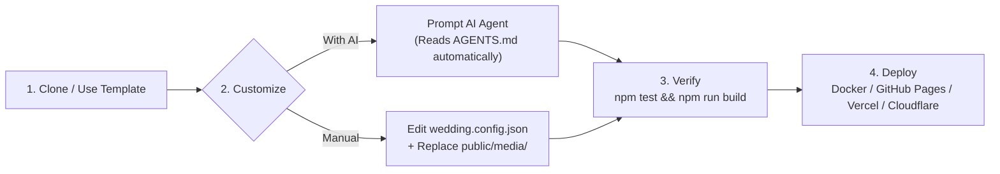

# Wedding Invitation Template (VI / EN — AI-Ready)

A reusable, production-hardened wedding & anniversary invitation template built with **React 19 + TypeScript + Vite 6 + Zod v4**, designed for **clone-per-wedding** customization — either manually or in 2 minutes using any AI coding assistant (**Antigravity, Claude Code, Cursor, Codex, GitHub Copilot**).



---

## Quick Start with AI (Recommended — 2 Minutes)

This repository includes [`AGENTS.md`](./AGENTS.md) and [`CLAUDE.md`](./CLAUDE.md) plus [`wedding.schema.json`](./wedding.schema.json) so AI coding assistants immediately understand the structure, validation rules, media layout, and security checks.

1. **Clone / Use this template** and open the folder in your AI IDE / CLI.
2. **Copy your photos** into `public/media/` (or tell the AI where your photos are on disk so it converts them to WebP and places them in `public/media/`).
3. **Paste and fill in one of the prompts below:**

### Prompt mẫu (Tiếng Việt)

```text
Đọc AGENTS.md và cấu hình lại template thiệp cưới này cho đám cưới của chúng mình:
- Cô dâu: [Tên ngắn] ([Họ tên đầy đủ]) — giới thiệu: [1-2 câu]
- Chú rể: [Tên ngắn] ([Họ tên đầy đủ]) — giới thiệu: [1-2 câu]
- Gia đình nhà gái: Ông [...], Bà [...], địa chỉ [...]
- Gia đình nhà trai: Ông [...], Bà [...], địa chỉ [...]
- Ngày cưới: [YYYY-MM-DD HH:mm, giờ VN +07:00], ngày âm lịch: [...]
- Địa điểm & link Google Maps:
  1. Nhà gái: [Giờ, Địa chỉ, Link Maps]
  2. Nhà trai: [Giờ, Địa chỉ, Link Maps]
  3. Tiệc cưới: [Giờ, Địa chỉ, Link Maps]
- Mừng cưới: [Bật/Tắt] — Ngân hàng, STK, Chủ TK (dùng VietQR hay ảnh QR cục bộ)
- RSVP webhook: [URL Formspree/Web3Forms hoặc để trống]
- Giao diện: [classic-gold | romantic-rose | sage-green | traditional-red], ngôn ngữ mặc định [vi | en]
- Các mục muốn ẩn (nếu có): [...]
Sau khi sửa xong, hãy chạy toàn bộ kiểm tra (format, lint, typecheck, test, build) đảm bảo pass 100%.
```

### Sample Prompt (English)

```text
Read AGENTS.md and customize this wedding template for our wedding:
- Bride: [Short Name] ([Full Name]) — bio: [1-2 sentences]
- Groom: [Short Name] ([Full Name]) — bio: [1-2 sentences]
- Event date & timezone: [YYYY-MM-DDTHH:mm:ss+07:00], city: [City]
- Venues (title, time, address, Google Maps URL): [...]
- Theme preset: [classic-gold | romantic-rose | sage-green | traditional-red], default language: [en | vi]
- Features to disable (if any): [...]
- RSVP webhook URL (or leave empty for preview): [...]
After updating wedding.config.json and media paths, run format, lint, typecheck, test, and build to verify.
```

---

## Manual Customization (No Coding Required)

Requires **Node.js >= 24** (recommended **26.13.1 LTS**, see `.nvmrc`).

```bash
npm ci
npm run dev
```

You only need to touch **two places**:

### 1. Edit [`wedding.config.json`](./wedding.config.json)

- Open in VS Code for automatic field hints via [`wedding.schema.json`](./wedding.schema.json).
- Invalid dates, URLs, or hex colors fail fast with a clear message from Zod.
- Every text field supports either `{ "vi": "...", "en": "..." }` or a single string `"..."`.
- **Automatic SEO & Open Graph:** Vite automatically injects `<title>`, `<meta description>`, `og:title`, `og:description`, `og:image`, and generates `manifest.json` from `wedding.config.json`.

#### Feature Flags (`features` — all 15 enabled by default)

| Flag                       | What it controls                                                            |
| -------------------------- | --------------------------------------------------------------------------- |
| `showEnvelopeIntro`        | Interactive wax seal envelope opening screen (triggers music on tap)        |
| `showInvitationCard`       | Formal two-family stationery card (Bride & Groom parents + Lunar date)      |
| `showAnniversary`          | Automatic Countdown (future date) or Anniversary elapsed timer (past date)  |
| `showStory`                | Couple love story section                                                   |
| `showMilestones`           | 4-step wedding milestones band                                              |
| `showSchedule`             | Vertical wedding day timeline + Dress Code color swatches                   |
| `showGallery`              | 12-column editorial mosaic gallery + filters + touch-swipe Lightbox         |
| `showLocations`            | Venue cards with Google Maps links                                          |
| `showCalendar`             | Add to Google Calendar & download `.ics` buttons on venue cards             |
| `showGift`                 | Wedding Gift cards with local QR or dynamic VietQR + copy account button    |
| `showRsvp`                 | Controlled RSVP & wishes form (webhook POST or local preview mode)          |
| `showWishesWall`           | Live Guestbook wall beside RSVP (newly submitted wishes appear immediately) |
| `showGuestPersonalization` | Displays personalized greeting from `?guest=` or `?to=` URL param           |
| `showMobileDock`           | Sticky frosted-glass mobile quick-action dock (Venues, Gift, RSVP, Share)   |
| `showMusic`                | Floating background music player (plays `music.src`)                        |

#### Theme Presets (`theme.preset`)

| Preset            | Vibe                                  | Primary Accent |
| ----------------- | ------------------------------------- | -------------- |
| `classic-gold`    | Warm champagne & editorial gold       | `#BD945A`      |
| `romantic-rose`   | Soft dusty rose & ivory               | `#C27D82`      |
| `sage-green`      | Botanical garden minimalist           | `#6D8B74`      |
| `traditional-red` | Refined Vietnamese ceremonial crimson | `#B03A3A`      |

You can also override individual colors via `theme.customColors` (`accent`, `accentText`, `bgBlush`, `bgSidebar`).

### 2. Replace Media in [`public/media/`](./public/media/)

| Path in `public/media/`                     | Recommended Ratio & Size   | Used For                                             |
| ------------------------------------------- | -------------------------- | ---------------------------------------------------- |
| `hero.webp`                                 | 3:2 landscape (`1440×960`) | Full-screen Hero background & Open Graph preview     |
| `bride.webp`, `groom.webp`                  | 1:1 square (`480×480`)     | Couple profile avatars                               |
| `story.webp`                                | 3:4 portrait (`900×1200`)  | Our Story featured portrait                          |
| `banner-timer.webp`, `banner-thankyou.webp` | 3:2 landscape (`1200×800`) | Countdown & Thank-you full-width banners             |
| `gallery/1..6.webp`                         | 3:2 landscape (`1200×800`) | 6-photo editorial mosaic gallery & Lightbox          |
| `locations/1..3.webp`                       | 3:2 landscape (`800×533`)  | Venue cards                                          |
| `qr/bride-qr.webp`, `qr/groom-qr.webp`      | 1:1 square (`400×400`)     | Local bank QR images (optional if `useVietQr: true`) |
| `music.m4a` (or `.mp3`)                     | `< 3 MB`                   | Background music loop                                |

---

## Built-in URL Tools for Sharing on Zalo / Facebook

- **Personalized Guest Invitation:** Append `?guest=Anh+Hùng` (or `?to=...`) to display _"Trân trọng kính mời Anh Hùng"_ on both the Wax Seal Envelope and the Hero section.
- **Hidden Batch Link Generator:** Visit `/?invite-tool=1` (hidden from regular guests) to paste a list of guest names and copy personalized `?guest=...` links in bulk for Zalo/Messenger.

---

## Available Scripts

| Command                | Purpose                                                               |
| ---------------------- | --------------------------------------------------------------------- |
| `npm run dev`          | Start Vite dev server with live config validation                     |
| `npm run build`        | Validate config, type-check, and build production bundle into `dist/` |
| `npm run preview`      | Preview production build locally on port `4173`                       |
| `npm run typecheck`    | Run strict TypeScript checking (`tsc --noEmit`)                       |
| `npm run lint`         | Run ESLint flat config                                                |
| `npm run format`       | Format all files with Prettier                                        |
| `npm run format:check` | Verify Prettier formatting                                            |
| `npm test`             | Run Vitest unit & component tests                                     |

---

## Deployment Options

### 1. Docker & Unprivileged Nginx (Production)

Multi-stage build (`node:26.13.1-alpine` -> `nginx/nginx-unprivileged:1.31.10-alpine-slim`) with strict CSP, gzip compression, immutable asset caching, read-only root filesystem, and `/healthz` check:

```bash
docker compose up -d --build
```

> **RSVP Webhook + Docker/Nginx:** If you configure an external `rsvp.endpoint` (e.g. `https://formspree.io/f/...`), append its origin to `connect-src` in [`docker/security-headers.conf`](./docker/security-headers.conf).

### 2. GitHub Pages (Free)

Enable **Settings -> Pages -> Source: GitHub Actions** and push to `main`. The workflow in [`.github/workflows/deploy-pages.yml`](./.github/workflows/deploy-pages.yml) automatically sets `VITE_BASE_PATH` and deploys `dist/`.

### 3. Vercel / Cloudflare Pages

- **Build command:** `npm run build`
- **Output directory:** `dist`
- **Optional env var:** `VITE_BASE_PATH=/`
